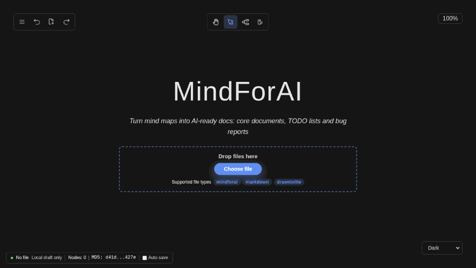

<div align="center">

# MindForAI

**Turn mind maps into AI-ready project documentation**

### 🌐 [Try MindForAI online](https://fantasylincen.github.io/mindforai/)

[](https://github.com/fantasylincen/mindforai/actions/workflows/deploy-pages.yml)
[](LICENSE)
[](CONTRIBUTING.md)
[](https://github.com/fantasylincen/mindforai/stargazers)
[](https://github.com/fantasylincen/mindforai/fork)
[](https://hub.docker.com/)
[](https://www.typescriptlang.org/)
[](https://react.dev/)

[中文](./README.md) · [Quick Start](#quick-start) · [Use Cases](#use-cases) · [File Formats](#file-formats) · [Templates](#template-library) · [Development](#development)

</div>

---



## What is this

**MindForAI is an open-source whiteboard for generating AI-ready project documentation.**

It is not just another Markdown editor — it is a **human–AI communication protocol for the AI era**: a structured tree document that removes natural-language ambiguity and lets the agent build exactly what you drew.

Sketch your project as a mind map, and MindForAI compresses it into a **compact text file that an AI assistant reads instantly**. Drop that file into Claude Code, Cursor, Copilot or any LLM agent — it immediately knows what the project does, where it stands, and what to do next.

**The problem it solves**: every new AI session starts from zero. You describe the background in prose and the model only half-understands it; you paste dozens of files and blow through your token budget. MindForAI lets you say it once — with one diagram and one file — and the context is complete.

## Our Ultimate Goal

**1 document + 1 agent = 1 project.**

We believe project delivery in the AI era can be reduced to this equation: one document that is clear enough, plus one agent that can understand it, is enough to ship a project.

MindForAI exists to rewrite the foundational documents agents work from with `.mindforai`: documents stop being background material for humans and become stricter, clearer, more explicit operating instructions for agents. Compared with Markdown, the tree structure puts goals, boundaries, constraints and acceptance criteria in deterministic positions, reducing ambiguity and goal drift — and giving agents noticeably stronger execution.

## Why MindForAI

**Natural language is a poor interface for commanding an AI.**

The same paragraph can be read in several ways: blurred concepts, ambiguous references, hidden assumptions and drifting goals all lead to answers that look reasonable but miss what you meant. The longer the conversation and the larger the text, the higher the chance that ambiguity is amplified — the model may latch onto irrelevant details, misread your intent, or treat an earlier mistake as a fact.

**That is why we strongly advise against large natural-language conversations with an AI, especially pasting an entire requirements document or design into the chat box at once.** Short, focused requirement snippets usually work fine because they stay narrow; but once multiple modules, constraints and acceptance criteria are involved, linear prose cannot express the relationships between them clearly.

MindForAI makes intent explicit as a tree. Each node carries exactly one concept, every parent–child edge is a task decomposition, and sibling nodes are parallel constraints. The AI no longer has to guess what you meant — it executes the nodes one by one.

- 🎯 **Ambiguity removed**: structured nodes replace prose. Goals, constraints and acceptance criteria each live in their own place, so the agent stays on track.
- 🧩 **Human–AI isomorphism**: a mind-map tree mirrors the branching structure of neurons. Both people and models build the big picture quickly.
- ⚡ **Token-efficient by design**: `.mindforai` uses indentation instead of brackets and commas — several times smaller than JSON and tighter than long-form Markdown.
- ✂️ **Cheaper reading**: the agent follows only the branch it needs to locate the change, avoiding full-repo searching and context pollution.
- 👀 **Readable by humans, even more readable by AI**: people see the whole picture at a glance; models parse the tree directly without guessing how paragraphs relate.
- 📝 **Easier to edit *and* easier to read than Markdown**: add, remove, re-level and duplicate branches like an outline — no heading hierarchy or list markers to maintain.
- ♻️ **Node-level reuse**: an AI rule or project constraint is a single node — copy it into a new project and it just works.
- 🎯 **Ready for task assignment**: use it for product design, project breakdown and task dispatch; hand the task tree to an agent and it starts working.

> In one line: **readable by humans, even more readable by AI — the best communication data structure between humans and AI in the AI era.**

## Use Cases

MindForAI is more than a drawing tool: it is a **specification an AI can execute directly**. Each of the following can be built as one tree and exported as a single `.mindforai` file.

| Scenario | What you structure in MindForAI | What the AI receives |
| --- | --- | --- |
| 🧭 **Requirements document design** | Target users → scenarios → functional boundaries → constraints → acceptance criteria | Implementation that respects the agreed scope instead of inventing features |
| 🧠 **Project core document** | Purpose → modules → directory layout → dependencies → navigation entry points | A global picture first, then precise code locations; large projects can be split into small modules an AI can implement independently |
| 🤖 **AI rules, persona and skills** | Role → behavioural boundaries → output style → skill list → prohibitions | Consistent collaboration rules in every session, without repeating context and preferences |
| 🗺️ **Code map / source navigation** | Folder → file → one-line responsibility (guided by the directory tree) | The agent follows the tree to locate files instead of searching the whole repo; decompose down to individual files, keep each file under 800 lines, and stop there |
| 🧩 **Project breakdown and task dispatch** | Milestones → independently deliverable modules → tasks → acceptance criteria | One module per AI session, running in parallel without polluting each other's context |
| ✅ **TODO list** | Requirement → subtasks → acceptance criteria | The agent starts working instead of asking clarifying questions |
| 🐛 **Bug report** | Symptom → repro steps → expected vs. actual | Precise localisation and a ready-to-apply fix |
| 🏗️ **Architecture / technical plan** | Current state → target architecture → migration steps | The agent implements *your* plan instead of inventing its own |
| ✍️ **Non-engineering use** | Writing outlines, event plans, learning paths, product analyses, meeting notes | Any content that benefits from structured thinking and reuse can become a clear document |

> When building a code map, add these rules for the AI: decompose to individual files, keep each file under 800 lines, describe each file and folder in one line, and do not decompose further.

## Features

- 🗺️ **Mind maps and flowcharts** in one whiteboard
- 🤖 **AI-native export format**: `.mindforai` (line-based tree text) is several times smaller than raw JSON and far more token-efficient
- 🧠 **Structured context**: hierarchy replaces long prose; goals, constraints and steps are stated once, cutting the risk of misread intent
- 🎯 **Precise change targeting**: module IDs plus branch paths let the agent navigate the tree instead of searching the whole repository
- 📦 **Reusable document templates**: project core document / task board / bug report / working methods / code review — see the [template library](./templates/)
- ✂️ **Reusable nodes**: copy a rule, constraint or task template into another project with one node
- 🔗 **Mermaid mind maps**: paste Mermaid text and get an editable map — ideal for migrating existing docs
- 🩹 **Broken-file recovery**: parse errors are highlighted with a one-click formatter, so files damaged by an AI can be rescued
- 💾 **Local-first**: documents only live in the local files you open, nothing is uploaded to a server; the browser only caches the current document text for refresh recovery (cleared when the file is closed)
- 🖼️ **Multiple export formats**: PNG / SVG / `.mindforai` / `.drawnixlite`
- ⌨️ **Multi-window editing**: open several documents side by side
- 🌐 **Multilingual UI**: English / 中文 / Русский / العربية / Tiếng Việt
- 📱 **Mobile-friendly with an infinite canvas**: zoom, pan and theme switching
- 🚀 **Online and self-hosted**: open the [GitHub Pages build](https://fantasylincen.github.io/mindforai/) directly, or deploy with Docker on your own machine
- ♻️ **MIT licensed**: free for commercial use, modification and self-hosting

## Quick Start

### Use it online

Open <https://fantasylincen.github.io/mindforai/> — no installation or sign-up required.

> Documents only live in the local files you open and are never uploaded to a server.

### Deploy locally with Docker

> **All you need is Docker** installed on your machine. One command installs, deploys and runs.

#### Step 1 — Clone the repository

```bash
git clone https://github.com/fantasylincen/mindforai.git
cd mindforai
```

#### Step 2 — One-click deploy and run

**Windows** (just double-click, no terminal needed):

```
rundocker.bat
```

**macOS**:

```bash
bash rundocker-macos.sh
```

**Linux**:

```bash
bash rundocker-linux.sh
```

**Any OS with Bash**: `bash rundocker.sh`

The script checks Docker, builds the image, starts the container, waits until the service is healthy and **opens your browser automatically**.

Then visit **<http://localhost:8080>**. The container is started with `docker run --rm`, so it is removed automatically as soon as it stops (Docker Desktop stop button, `docker stop mindforai`, or `bash rundocker.sh stop`).

> Need a different port? `MINDFORAI_PORT=9000 bash rundocker.sh`
>
> See [`deploy/README.md`](./deploy/README.md) for the full deployment guide.

### Prefer running locally without Docker?

**Windows**: double-click `runsrc.bat` (double-click again to restart, `runsrc.bat stop` to stop)

**macOS / Linux**: `bash runsrc.sh` (run again to restart, `bash runsrc.sh stop` to stop)

The script installs dependencies, starts the dev server in the background and opens <http://localhost:7200> once the port is reachable.

Or run it manually:

```bash
npm install
npm start
```

### Build for production

```bash
npm install
npm run build:web      # output goes to dist/apps/web
```

## File Formats

MindForAI supports two document formats, selectable from the **Save As** menu:

| Format | Extension | Content | Best for |
| --- | --- | --- | --- |
| **MindForAI** | `.mindforai` | Compact text tree | **Preferred** — feed it to an AI: small, and the hierarchy is obvious |
| **DrawnixLite** | `.drawnixlite` | Slimmed-down JSON tree | Intermediate format for programmatic parsing |

Here is what a `.mindforai` file looks like (a TODO list):

```text
type: mindforai
version: 1
content[1]:
  - text: TODOS
    children[2]:
      - Read the project core document first ./project.mindforai
      - text: Rules
        children[1]:
          - The final report to the user must be written in Chinese
```

Format rules: node text is never wrapped in double quotes and follows `-` directly; every leaf node occupies its own line instead of being joined with commas.

**Why this text format?** Compared with JSON, it expresses hierarchy through indentation, which removes a large amount of bracketing and commas. The result is a smaller file, fewer tokens and a structure that models parse more intuitively. Compared with Markdown, there is no heading hierarchy or list-marker bookkeeping: branches can be dragged, copied and reused as whole units, making the document easier for both humans and models to navigate and rewrite.

## Template Library

[`templates/Templets.mindforai`](./templates/Templets.mindforai) is a single template collection you can drop straight into MindForAI. It puts real project documents, task boards, everyday working methods and code review flows into one tree:

- **Example project A: mindforai**: project core document, completed / in-progress tasks, TODO and usage instructions
- **Example project B: BeamStreamS3**: an ESP32-S3 Wi-Fi microphone — hardware conventions, firmware modules, configuration protocol and task records
- **The author's working methods**: running Docker with a local agent, one-click deploy scripts, common AI workflows for the web edition, and the first step when starting work on an old project
- **Our ultimate goal**: 1 document + 1 agent = 1 project

Download the file, drop it into your project root, or open it directly in MindForAI and adapt it. You can also right-click and copy only the branch you need and keep it as a standalone document. You are welcome to submit the templates you use most often to the [`templates/`](./templates/) directory so others can reuse them.

## When a file is broken

When you open or drop a file, MindForAI first detects the format by extension, then falls back to the type declaration at the top of the file. If the content cannot be parsed (for example, a `.mindforai` file damaged by an AI), a text repair dialog appears:

- Syntax highlighting for both `.mindforai` and `.drawnixlite`
- Broken lines are underlined in red with “line N + reason”; click to jump to the line
- One-click **Format**, **Save** back to the same file, or **Validate and open** after fixing

## How to use it

1. **Break it down** — split the project into a tree of modules → files → responsibilities, tagging key nodes with module IDs and file paths
2. **Draw it** — open MindForAI and complete the structure with the mind map tool; each rule, constraint and acceptance criterion gets its own node
3. **Save it** — *Save As* → `MindForAI File (.mindforai)`
4. **Feed the AI** — put the `.mindforai` file in your project root, or paste it straight into your assistant; the agent follows the tree instead of searching the whole repo

Kick off a Claude Code / Cursor session like this:

```
Please read ./project.mindforai first, locate change points by module ID and file path instead of searching the whole repo, then ...
```

> Recommended workflow: break the project down into modules first, then dispatch the work. The clearer the tree, the faster the agent finds the change point and the fewer tokens are wasted.

## UI notes

- **The default theme is “Dark”**; switch it from the theme menu in the lower-right corner.
- **“Open new window”** (top-left menu → Open new window) opens a blank canvas in a new tab, independent of the current document — handy for editing several documents at once.
- **The page title follows the file name**: after opening a file, the browser tab becomes `file name - MindForAI`, and the toolbar shows the current file name.

## Development

### Requirements

- Node.js 20+ ([nvm](https://github.com/nvm-sh/nvm) recommended; the repo ships an `.nvmrc`)
- npm 10+

### Common commands

```bash
npm start            # start the dev server
npm run build        # build every package
npm run build:web    # build the web app only
npm test             # run all unit tests
npm run lint         # lint the codebase
npm run format       # format the codebase
node scripts/generate-icons.mjs 03-chat   # generate icon candidates and activate 03
```

### Deploy to GitHub Pages

The repo includes a [deploy-pages.yml](./.github/workflows/deploy-pages.yml) workflow: pushing to `main` builds and publishes the site automatically.

1. In **Settings → Pages → Build and deployment**, set Source to **GitHub Actions**.
2. The workflow sets `GITHUB_PAGES=true` so Vite builds with `/mindforai/` as the base path; Docker and local development keep the root path.
3. Published at <https://fantasylincen.github.io/mindforai/>.

### Repository layout

```
mindforai/
├── apps/
│   ├── web/                  # Web application (Vite + React 19)
│   └── web-e2e/              # Playwright end-to-end tests
├── packages/
│   ├── mindforai/            # Core whiteboard library (components + plugins + serialisation)
│   ├── react-board/          # React rendering layer for the board
│   └── react-text/           # Rich text rendering module
├── templates/                # Reusable .mindforai document templates
├── .github/workflows/        # Automated GitHub Pages deployment
├── runsrc.sh / runsrc.ps1 + runsrc.bat        # One-click local dev launcher
├── rundocker.sh / rundocker-*.sh / rundocker.ps1 + .bat  # One-click Docker deploy
├── deploy/                   # Launch & deploy guide (scripts live in the repo root)
├── docs/                     # Project documentation
├── Dockerfile                # Multi-stage build: Node build → static site
├── docker-compose.yml        # Optional compose setup (scripts use docker run --rm)
└── package.json              # Nx monorepo root
```

## Tech Stack

- **Framework**: [Plait](https://github.com/worktile/plait) — the open-source drawing framework
- **Frontend**: React 19 + TypeScript + Vite + Nx monorepo
- **Rich text**: [Slate](https://github.com/ianstormtaylor/slate)
- **AI format**: line-based indented tree text (legacy TOON documents are still readable)
- **Deployment**: GitHub Pages + Docker + static site hosting

## Acknowledgements

**Heartfelt thanks to the original [Drawnix](https://github.com/plait-board/drawnix) project and its developers, and to every developer, researcher, open-source contributor and model / tool provider who contributes to the AI ecosystem.**

MindForAI grew out of Drawnix. We are especially grateful to the original Drawnix authors for their open-source work on the board engine, mind maps, flowcharts, the infinite canvas and the plugin architecture — their excellent work is what allows this project to start from such a strong foundation.

Special thanks also to the DeepSeek team for their model capabilities and open ecosystem, which put powerful AI programming within reach of individual developers and small teams.

Thanks also to the maintainers of the [Plait](https://github.com/worktile/plait) drawing framework, and to everyone who has helped MindForAI grow through issues, pull requests, documentation and feedback.

> ⚠️ This is an independent derivative project and is not affiliated with the original Drawnix team. The original project's trademarks and copyright remain with its authors.

## Contributing

Contributions of every kind are welcome — report issues, submit bugs, contribute code, improve the docs, or submit a useful [document template](./templates/).

Please read the [Contributing Guide](./CONTRIBUTING.md) and the [Code of Conduct](./CODE_OF_CONDUCT.md) before opening an issue or pull request.

## License

[MIT License](./LICENSE) © MindForAI Contributors
